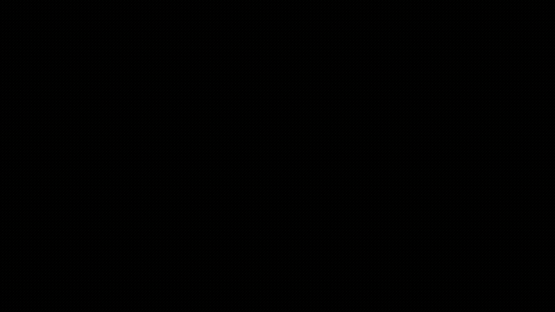
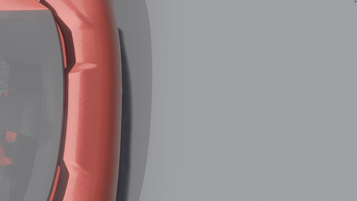
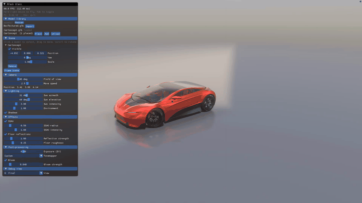

<div align="center">


**A from-scratch Vulkan renderer, built as a clean template to start your own engine from.**

<br>


<br>



</div>

<br>

## What is it

Black Glass is a small, readable physically based renderer written directly against Vulkan. There is no engine framework underneath it: windowing, memory, descriptors, passes and shaders are all in plain view.

It is meant to be a **standard template to start from**. Clone it, load your own glTF models, then cut it down or build on top of it.

<br>

<div align="center">

<br>
<sub>Real transmission: the camera looks through the glass roof into the cabin.</sub>
</div>

<br>

## Features

| | |
|---|---|
| **Lighting** | GGX PBR, image-based lighting, clearcoat, directional shadows |
| **Glass** | Transmission and sorted alpha blending |
| **Post** | HDR pipeline, 4x MSAA, bloom, SSAO, ACES / AgX / Khronos Neutral tonemapping |
| **Scene** | glTF loading, model library, click-to-place, glossy floor reflections |
| **Tooling** | Dear ImGui panel, runtime debug views, VMA memory allocation |

<br>

<div align="center">

<br>
<sub>Selection: The selection tool in action.</sub>
</div>

<br>


## Quick start

You need the Vulkan SDK (for `slangc`), GLFW and CMake.

```bash
./build.sh
```

Models are read from `src/assets/`. Open the **Model library** panel to import one, then place it in the scene.

<br>

## Controls

| Input | Action |
|---|---|
| Hold **right mouse** + `W A S D` | Fly the camera (`Space` up, `Shift` down) |
| **Left click** | Select a model, or place the ghost preview |
| **Drag** / **Scroll** | Move a model / rotate it |
| `Delete` | Remove the selected model |
| `Tab` | Toggle fly mode |
| `F1` | Hide the UI |
| `Esc` | Quit (asks first) |

<br>

<div align="center">
<sub>Built with Vulkan, GLFW, GLM, tinygltf, stb_image, Dear ImGui and VMA.</sub>
</div>
